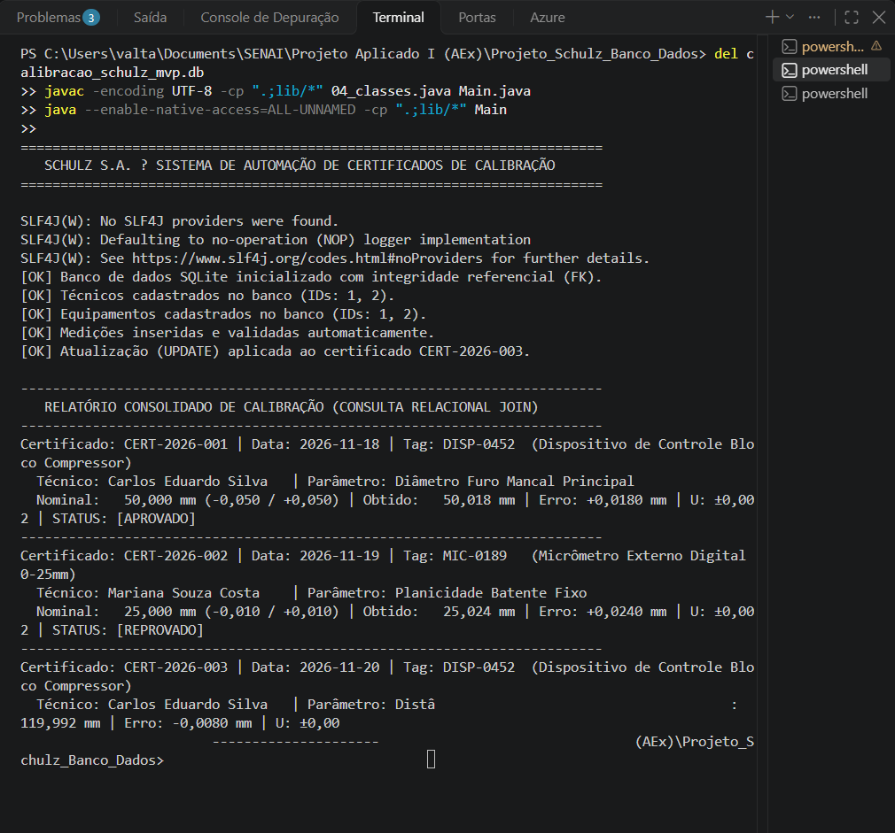

# Documentação Técnica — MVP (Parte 1): Arquitetura POO e Persistência SQLite

**Unidade Curricular:** Projeto Aplicado I (AEx)  
**Instituição:** UniSENAI — Análise e Desenvolvimento de Sistemas  
**Professor Orientador:** Prof. MSc. Hugo Menezes Barra e Prof. Rodrigo Losina  
**Empresa Parceira:** Schulz S.A.  
**Repositório GitHub:** https://github.com/ValtairWerlich/projeto-aplicado-schulz


**Equipe de Desenvolvimento:**
* Daniel Victor Sampaio Siqueira
* Davi Guilherme de Santana Rodovalho
* Lisandro Fernandes Mattos Leite
* Valtair Werlich

---

## 1. Visão Geral da Implementação (AV 03)

Na etapa atual do projeto, a modelagem relacional definida na Entrega 02 (`03_banco.sql`) foi convertida em uma aplicação orientada a objetos desenvolvida em **Java (JDK 17+)** com persistência em banco de dados relacional **SQLite** via driver **JDBC (`sqlite-jdbc`)**. 

O sistema automatiza o cálculo de desvio metrológico e a emissão de parecer de conformidade (`APROVADO` ou `REPROVADO`) a partir dos parâmetros extraídos da máquina de medição por coordenadas (**Calypso/Zeiss**), assegurando rastreabilidade conforme os requisitos das normas **ISO 9001** e **IATF 16949**.

---

## 2. Padrões de Programação Orientada a Objetos (POO) Utilizados

1. **Encapsulamento e Integridade de Domínio:**
   * Todos os atributos das entidades `Tecnico`, `Equipamento` e `Medicao` são declarados como `private`, expondo apenas métodos de acesso (`getters`) e modificação controlada (`setters`).
   * Na classe `Tecnico`, o método `setFlSignatarioAutorizado()` valida se o valor pertence ao domínio `{0, 1}`, espelhando a restrição `CHECK` do banco de dados antes mesmo da tentativa de persistência.
   * Na classe `Equipamento`, o construtor aplica valor padrão (`"Não consta"`) caso o fabricante seja omitido ou nulo.

2. **Coesão e Regra de Negócio Encapsulada (`Medicao`):**
   * O algoritmo de cálculo de erro (\(Erro = Valor_{Obtido} - Valor_{Nominal}\)) e validação de tolerância está encapsulado no método `calcularErroEValidar()`.
   * Sempre que uma medição é instanciada ou tem seu `vlrObtido` alterado via `setVlrObtido()`, o erro e o `dsStatus` (`APROVADO` se \(Nominal - Tol_{Inf} \le Obtido \le Nominal + Tol_{Sup}\); caso contrário, `REPROVADO`) são recalculados automaticamente, eliminando falhas manuais de digitação.

3. **Separação de Responsabilidades — Padrão DAO (*Data Access Object*):**
   * Toda a comunicação com o SQLite foi isolada na classe `BancoDadosDAO`, desacoplando as regras metrológicas da camada de infraestrutura SQL.

---

## 3. Diagramação Textual / UML das Classes

```text
+-------------------------------------------------------+

|                        Tecnico                        |
+-------------------------------------------------------+

| - idTecnico: int                                      |
| - nmTecnico: String                                   |
| - dsCargo: String                                     |
| - dsSetorSolicitante: String                          |
| - flSignatarioAutorizado: int                         |
+-------------------------------------------------------+

| + Tecnico(...)                                        |
| + getIdTecnico(): int                                 |
| + setFlSignatarioAutorizado(flag: int): void          |
+-------------------------------------------------------+
                           ^
                           | 1 (id_tecnico)
                           |
                           | *
+-------------------------------------------------------+

|                        Medicao                        |
+-------------------------------------------------------+

| - idMedicao: int                                      |
| - idEquipamento: int                                  |
| - idTecnico: int                                      |
| - nrCertificado: String                               |
| - nrOs: String                                        |
| - dtCalibracao: String                                |
| - parametroNm: String                                 |
| - vlrNominal: double                                  |
| - tolSuperior: double                                 |
| - tolInferior: double                                 |
| - vlrObtido: double                                   |
| - vlrErro: double                                     |
| - vlrIncertezaExp: double                             |
| - dsStatus: String                                    |
+-------------------------------------------------------+

| + Medicao(...)                                        |
| + calcularErroEValidar(): void                        |
| + setVlrObtido(vlrObtido: double): void               |
| + getDsStatus(): String                               |
+-------------------------------------------------------+
                           | *
                           |
                           | 1 (id_equipamento)
                           v
+-------------------------------------------------------+

|                      Equipamento                      |
+-------------------------------------------------------+

| - idEquipamento: int                                  |
| - cdEquipamento: String                               |
| - nmDenominacao: String                               |
| - nmFabricante: String                                |
| - vlrNominalGeral: double                             |
| - dsLocalizacao: String                               |
+-------------------------------------------------------+

| + Equipamento(...)                                    |
| + getIdEquipamento(): int                             |
| + getCdEquipamento(): String                          |
+-------------------------------------------------------+

+-------------------------------------------------------+

|                     BancoDadosDAO                     |
+-------------------------------------------------------+

| - urlConexao: String                                  |
+-------------------------------------------------------+

| + conectar(): Connection                              |
| + inicializarTabelas(): void                          |
| + inserirTecnico(t: Tecnico): int                     |
| + inserirEquipamento(e: Equipamento): int             |
| + inserirMedicao(m: Medicao): int                     |
| + atualizarLeituraMedicao(m: Medicao): void           |
| + gerarRelatorioCalibracaoJoin(): List<String>        |
+-------------------------------------------------------+
```

---

## 4. Tratamento de Erros SQL e Segurança de Dados

* **Integridade Referencial Ativa:** Em cada abertura de sessão no método `conectar()`, o sistema executa `PRAGMA foreign_keys = ON;`, garantindo que o SQLite bloqueie medições vinculadas a técnicos ou equipamentos inexistentes.
* **Prevenção contra SQL Injection e Tipagem:** Todas as operações de escrita e atualização (`inserirTecnico`, `inserirEquipamento`, `inserirMedicao`, `atualizarLeituraMedicao`) utilizam `PreparedStatement` parametrizado.
* **Gerenciamento Automático de Recursos (`try-with-resources`):** Objetos `Connection`, `PreparedStatement`, `Statement` e `ResultSet` são instanciados dentro de blocos `try (...)`, assegurando o fechamento automático das conexões mesmo em caso de exceção e evitando bloqueios no arquivo `.db` (`SQLITE_BUSY`).
* **Captura Estruturada na Camada Principal:** A classe `Main` trata separadamente falhas de banco de dados (`SQLException`, exibindo código de erro e mensagem) e violações de regra de negócio (`IllegalArgumentException`).

---

## 5. Validação do Fluxo Funcional do MVP

A execução da classe `Main.java` valida ponta a ponta o fluxo operacional do sistema:

1. **Provisionamento:** Criação automática das tabelas `tb_tecnico`, `tb_equipamento` e `tb_medicao` com chaves primárias, estrangeiras e restrições `CHECK`.
2. **Cadastro de Entidades Base:** Inserção de técnicos calibradores e instrumentos de medição com recuperação automática das chaves primárias geradas (`Statement.RETURN_GENERATED_KEYS`).
3. **Processamento Metrológico (`INSERT`):**
   * *Certificado `CERT-2026-001`*: Valor nominal `50.000 mm` ($\pm 0.050\text{ mm}$), leitura `50.018 mm` $\rightarrow$ Erro calculado `+0.0180 mm` $\rightarrow$ Status **`APROVADO`**.
   * *Certificado `CERT-2026-002`*: Valor nominal `25.000 mm` ($\pm 0.010\text{ mm}$), leitura `25.024 mm` $\rightarrow$ Erro calculado `+0.0240 mm` $\rightarrow$ Status **`REPROVADO`**.
4. **Retificação de Leitura (`UPDATE`):** O certificado `CERT-2026-003` (inicialmente `REPROVADO` com `120.045 mm`) recebe nova leitura de `119.992 mm` via `setVlrObtido()`, recalculando o erro para `-0.0080 mm` e atualizando o banco para **`APROVADO`**.
5. **Rastreabilidade (`SELECT` com `INNER JOIN`):** Cruzamento das três tabelas para exibição do relatório final consolidado no terminal.
### Evidência de Execução no Terminal

